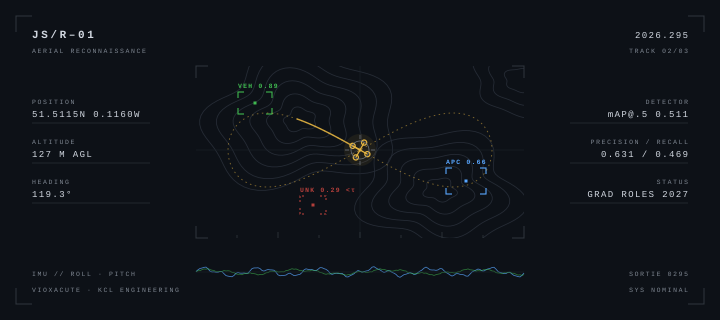

<picture>
  <source media="(prefers-color-scheme: dark)" srcset="./banner-dark.svg">
  <source media="(prefers-color-scheme: light)" srcset="./banner-light.svg">
  
</picture>

<h2 align="center">Hi, I'm James 👋</h2>

  Final-year <b>BEng General Engineering</b> student at <b>King's College London</b> 
  Machine learning · Computer vision · Embedded systems

  
  

---

### About me

- 🎓 Final-year engineering student at KCL, taking modules in machine learning, control systems and hardware design
- 🔭 Final-year project: **vision-based detection of anchoring sites for robotic aerial base stations** — computer vision for UAVs
- 🧠 I like working from first principles: understanding *why* a model or system behaves the way it does, not just getting it to run
- 💼 Looking for **graduate software, ML and engineering roles in the UK from Summer 2027**

---

### 🚀 Featured projects

<table>
<tr>
<td width="50%" valign="top">

#### 🛰️ Aerial Military Vehicle Detector

YOLOv8n fine-tuned to detect tanks, APCs, fighters, bombers and soldiers in drone and satellite imagery, with an analysis of the precision–recall trade-off for ISR use.

**mAP@0.5 0.51** · precision 0.63 · recall 0.47

`PyTorch` `Ultralytics` `OpenCV` `Streamlit`

[**Live demo**](https://aerial-vehicle-detector.streamlit.app) · [Code](https://github.com/Vioxacute/satellite-vehicle-detector)

</td>
<td width="50%" valign="top">

#### 🏠 London House Price Predictor

Random Forest model that predicts average house prices across London boroughs from salary, crime, population and housing data, served as an interactive web app.

**R² 0.990** · MAE £8,312 on held-out data

`scikit-learn` `pandas` `Streamlit` `Render`

[**Live app**](https://london-house-price-predictor.onrender.com) · [Code](https://github.com/Vioxacute/london-house-price-predictor)

</td>
</tr>
<tr>
<td width="50%" valign="top">

#### 💳 Credit Risk PD Model

Probability-of-default model built on a calibrated logistic regression pipeline. Scores applications into risk grades and runs a stress test, evaluated with AUC, KS and Brier score.

`scikit-learn` `pandas` `matplotlib`

[Code](https://github.com/Vioxacute/C_R_M)

</td>
<td width="50%" valign="top">

#### 🗂️ Code Snippet Manager

Flask web app for saving and organising code snippets, with form handling and a database-backed model layer.

`Flask` `Python` `HTML/CSS`

[Code](https://github.com/Vioxacute/Code_Snippet_Manager)

</td>
</tr>
</table>

---

### 🔧 Hardware

**Autonomous quadcopter** — flight controller written in C++ on an Arduino Nano, with IMU-based stabilisation and Wi-Fi control.

---

### 🧰 Tech stack

**Languages** 

**ML & data** 

**Web & deployment** 

**AI tooling** 

**Hardware & tools** 

